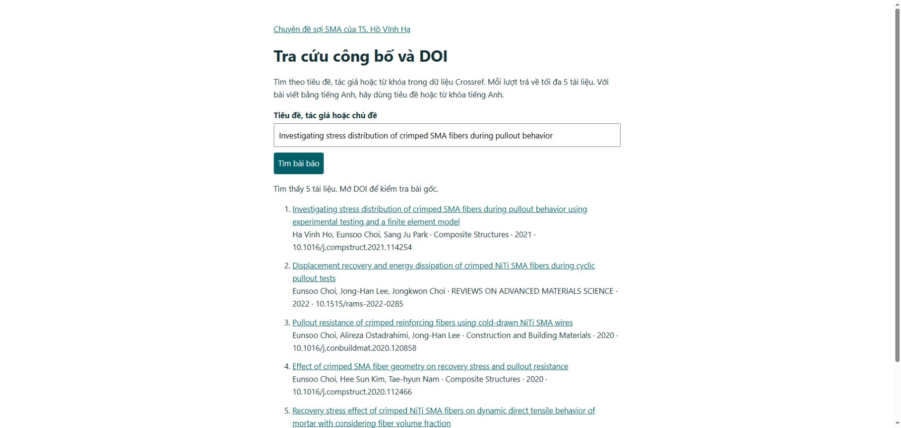

# Worked example · Tìm bài về kéo tuột sợi SMA trong vữa

This bilingual example accompanies three papers co-authored by Hồ Vĩnh Hạ (Vinh-Ha Ho). The queries contain neither an author's name nor a DOI. Crossref returns candidate works by any author in its own order. The DOI links below let readers check the example against the original studies.

| Câu hỏi | Example English query for Crossref | Published source to check |
| --- | --- | --- |
| Ứng suất tập trung ở đâu quanh nếp uốn của sợi SMA trong quá trình kéo tuột? | stress distribution crimped SMA fibers pullout mortar experimental finite element | [Composite Structures, 2021](https://doi.org/10.1016/j.compstruct.2021.114254) |
| Chiều dài chôn và độ sâu sóng ảnh hưởng thế nào đến liên kết của sợi? | analytical bond behavior cold drawn crimped SMA fibers embedded length fiber wave depth | [Reviews on Advanced Materials Science, 2021](https://doi.org/10.1515/rams-2021-0066) |
| Góc đặt sợi ảnh hưởng thế nào đến quá trình kéo tuột trong mô hình phần tử hữu hạn? | inclined superelastic shape memory alloy fiber mortar pullout finite element | [Arabian Journal for Science and Engineering](https://doi.org/10.1007/s13369-024-09002-9) |

**How to use the example.** Choose a question and send the English keywords to `research_papers`, with `limit: 5` and the actual discovery channel. Inspect each candidate title, author, year and DOI. Read the original paper before citing a stress pattern, bond parameter or an angle. Record an empty or irrelevant result as such. For a different topic, try “chloride diffusion coefficient recycled aggregate concrete” and check that paper on its own merits.

**Đọc thêm.** Trang chuyên đề của tác giả có diễn giải tiếng Việt, phần tiếng Anh, điều kiện mô hình, liên kết bài gốc và BibTeX. [Ba nghiên cứu về kéo tuột sợi SMA](https://hovinhha-research.pages.dev/topics/sma-pullout/?utm_source=github&utm_medium=referral&utm_campaign=sma_pullout&utm_content=mcp_worked_example)

## Try the public search

[Open the DOI search page](https://donvi108-agent-hub-live-preview.donvi108.workers.dev/research). The page starts with a paper title and submits only when you choose **Tìm bài báo**. No account or token is required.

During a live check on 21 November 2026, the title search returned the *Composite Structures* paper (10.1016/j.compstruct.2021.114254) first. An independent client connection through the MCPtry playground returned the embedded-length study (10.1515/rams-2021-0066) for the second query above. The third query also returned the inclined-fiber study (10.1007/s13369-024-09002-9) first. As a control, a search for “chloride diffusion coefficient recycled aggregate concrete” returned a different paper, 10.1007/s40069-015-0123-6, first. These are service checks. Search order can change as Crossref updates its records.

